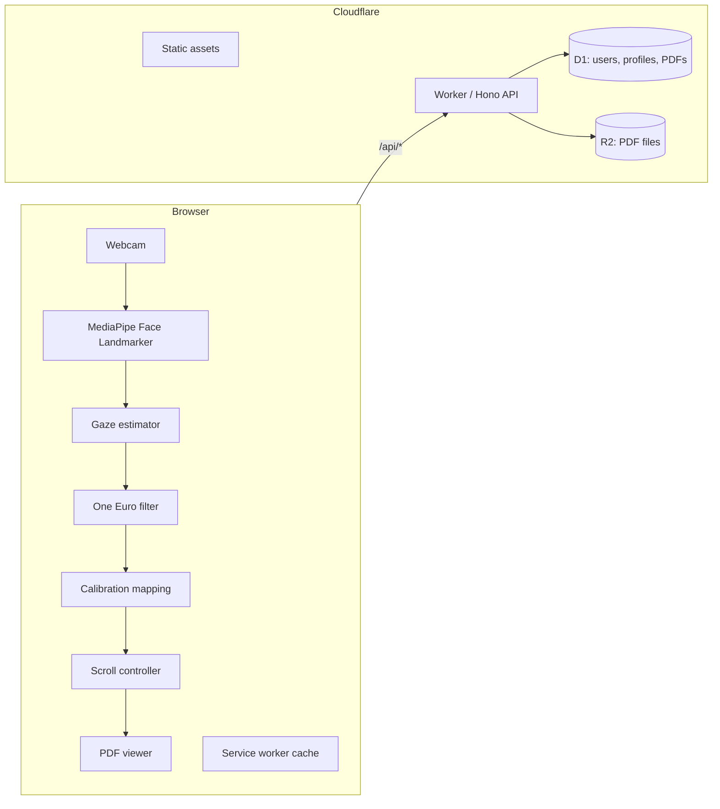

# SightRead

**Hands-free page turning for sheet music.** SightRead is a web app that scrolls a PDF score as you read it, using your webcam to follow where you are looking, so you never have to take your hands off the instrument.

Live site: **[sightread.ing](https://sightread.ing)**

[](https://github.com/patjandra/SightRead/actions/workflows/ci.yml)

## The idea

Musicians reading digital scores have two bad options: stop playing to scroll, or use tempo-based auto-scroll that never quite matches their pace. SightRead instead scrolls when your gaze reaches the lower part of the page (and back up when it reaches the upper part), so the scroll rate follows how fast you actually read.

## Features

- **Gaze-controlled scrolling.** Eye blendshapes from MediaPipe's face landmarker, blended with head pitch, are mapped to a vertical gaze position. Looking into the bottom zone scrolls down; the top zone scrolls up. The signal is smoothed with a One Euro filter, and brief dropouts such as blinks are tolerated.
- **Local, in-browser inference.** The face landmarker model and WASM runtime ship with the app (`public/mediapipe-*`) and run on your device.
- **3-point calibration** (top, middle, bottom of the page), with a calibration check and a recenter step.
- **Per-user profiles.** Keep several calibration profiles (for example per room or seat) and switch between them. Profiles are stored locally by default.
- **Optional Google sign-in.** Signing in lets you save calibration profiles and PDFs to your account and use them across devices. The app works without an account.
- **PDF library.** Signed-in users can save PDFs to their account (duplicate files are detected by SHA-256). Limits: 25 MB per file, 100 files and 500 MB per user.
- **Offline support.** A service worker caches the app shell, hashed bundles, and the MediaPipe files; PDFs can also be kept as offline copies.
- **Reader controls.** Zoom, sensitivity, a configurable keyboard shortcut to start/pause tracking, automatic pause when you scroll manually, and a notice when tracking is lost.

## Privacy

- Webcam video is processed in your browser and is **never uploaded or stored**.
- Without an account, calibration data stays in your browser.
- With an account, the server stores your Google identity (subject ID, email, name, picture), your calibration values, and the PDFs you choose to save. PDFs live in a private R2 bucket and are only served through the authenticated Worker.
- The service worker never caches `/api/*` responses or non-GET requests.

See the in-app Privacy and Terms pages (`/privacy`, `/terms`).

## Tech stack

| Layer | Technology |
| --- | --- |
| UI | React 18, React Router, Tailwind CSS, Vite |
| PDF rendering | `react-pdf` / `pdfjs-dist` |
| Gaze tracking | `@mediapipe/tasks-vision` (Face Landmarker, self-hosted model and WASM) |
| API | Cloudflare Worker using Hono |
| Auth | Google Identity Services ID token, verified with `jose`; signed session cookie |
| Database | Cloudflare D1 (SQLite) |
| File storage | Cloudflare R2 |
| Offline | Service worker (`public/sw.js`) |
| Tests / CI | Vitest, Testing Library, GitHub Actions (Node 22, see `.nvmrc`) |

## Architecture



The Worker serves the built SPA from `dist/` (with SPA fallback) and runs first only for `/api/*`:

| Route prefix | Purpose |
| --- | --- |
| `/api/auth` | Google sign-in, session |
| `/api/calibrations` | Sync calibration profiles (soft deletes so other devices learn of removals) |
| `/api/pdfs` | Save, list, fetch, delete account PDFs |
| `/api/account` | Account management |

State-changing requests are protected by an Origin check and a custom-header CSRF middleware on top of `SameSite=Lax` cookies.

## Getting started

Requires Node 22 (as used in CI) and npm.

```bash
npm install
cp .dev.vars.example .dev.vars   # then edit; see Configuration
npm run db:migrate:local         # create the local D1 tables
npm run dev                      # Vite on :5173 + wrangler dev on :8787
```

| Script | What it does |
| --- | --- |
| `npm run dev` | Run the web app and Worker API together |
| `npm run dev:web` / `npm run dev:api` | Run only one of the two |
| `npm test` | Run the Vitest suite once |
| `npm run test:watch` | Vitest in watch mode |
| `npm run build` | Production build into `dist/` |
| `npm run preview` | Preview the built app |
| `npm run db:migrate:local` / `:staging` / `:production` | Apply D1 migrations |
| `npm run deploy:dry-run` | Build and dry-run a staging deploy |
| `npm run deploy:staging` / `deploy:production` | Build and deploy |

Webcam access requires a secure context; `localhost` qualifies.

## Configuration

`wrangler.jsonc` defines three environments: top level (local `wrangler dev`), `staging` (Worker `sightread-staging`), and `production` (Worker `sightread-production`, custom domain `sightread.ing`). Each has its own D1 database and R2 bucket (`PDFS`), and bindings are repeated per environment because Wrangler does not inherit them.

Local variables go in `.dev.vars` (gitignored); `.dev.vars.example` is the template:

| Variable | Purpose |
| --- | --- |
| `SESSION_SECRET` | Signs session cookies; use at least 32 random characters (`openssl rand -base64 32`) |
| `GOOGLE_CLIENT_ID` | Google OAuth web client ID (public value; set under `vars` in `wrangler.jsonc` per environment) |
| `ALLOWED_ORIGINS` | Local dev only: allows the Vite origins (`http://localhost:5173`, `http://127.0.0.1:5173`) through the CSRF check |
| `SPOTIFY_TOKEN_KEY` | Encrypts remembered Spotify logins (AES-256-GCM); 32 random bytes, base64 (`openssl rand -base64 32`) |
| `INSECURE_DEV_COOKIES` | Local dev only: non-Secure cookies for Safari on `http://localhost` |

To run your own copy, create a Google OAuth web client and a D1 database and R2 bucket per environment, then put your own client IDs and database IDs in `wrangler.jsonc`.

## Deployment

```bash
# one-time per environment: secret for session cookies
npx wrangler secret put SESSION_SECRET --env staging
npx wrangler secret put SESSION_SECRET --env production
npx wrangler secret put SPOTIFY_TOKEN_KEY --env staging
npx wrangler secret put SPOTIFY_TOKEN_KEY --env production

# apply schema migrations (migrations/*.sql)
npm run db:migrate:staging
npm run db:migrate:production

# build and deploy
npm run deploy:staging
npm run deploy:production
```

`ALLOWED_ORIGINS` and `INSECURE_DEV_COOKIES` should be unset in staging and production.

### CI/CD

`.github/workflows/ci.yml` runs on every pull request and on pushes to `main` and `vibeWeb`:

1. `npm ci`, then `npm audit --omit=dev --audit-level=high`
2. `npm test`: unit and API tests, plus checks that the migrations apply in order to a fresh database and that `wrangler.jsonc` is complete for every environment (including that the Spotify client ID matches `src/config.js`)
3. `npm run build`
4. `wrangler deploy --dry-run` for staging and production (bundles the Worker with each environment's config; needs no Cloudflare login)

A push to **`vibeWeb`** that passes also **deploys to staging**: it applies the migrations (`db:migrate:staging`), then runs `deploy:staging`. Pull requests never deploy. Worker secrets stay in Cloudflare and are not touched.

**Production is deployed by hand**, after checking staging:

```bash
npm run db:migrate:production   # only when there are new migrations
npm run deploy:production
```

One-time setup for the staging deploy: create a Cloudflare API token for this account with Workers Scripts: Edit, D1: Edit and Workers R2 Storage: Edit, then add it as `CLOUDFLARE_API_TOKEN`, together with `CLOUDFLARE_ACCOUNT_ID`, as secrets of a GitHub environment named `staging` (Settings, Environments). Until they exist the staging deploy job fails; pull request checks are unaffected.

## Project structure

```
src/
  App.jsx, main.jsx, config.js     routes, entry, shared gaze/scroll tunables
  features/
    reader/                        reader page, PDF viewer, controls, keybinding
      gaze/                        estimator, calibration, filter, profile store and sync
      scroll/                      scroll controller
      hooks/, components/
    library/                       account PDF library and offline copies
    auth/                          Google sign-in and session client
    legal/                         privacy and terms pages
worker/
  index.js                         Hono app
  routes/, services/, middleware/  API handlers, D1/R2/session logic, CSRF and auth
migrations/                        D1 schema (users, calibration profiles, PDFs, PDF hash, Spotify links)
public/
  sw.js                            service worker
  mediapipe-models/, mediapipe-wasm/
wrangler.jsonc                     Worker, assets, D1, R2, environments
.github/workflows/ci.yml           audit, test, build, Worker dry run; staging deploy
```

## Contributing

Run `npm test` and `npm run build` before opening a pull request; CI runs both, plus a dependency audit and a Worker dry run.
